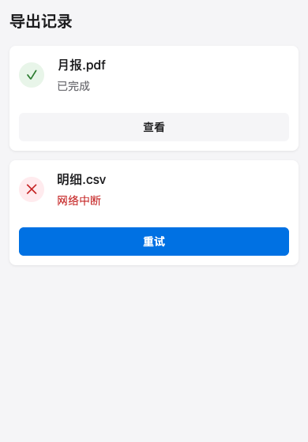

# UI Guard

面向前端与原型的设计流程 Skill：先定任务、对象和数据状态，再定视觉。参考 Apple/macOS 与 Linear 的层级、任务流和状态原则，帮 Web、桌面端和 App 删掉多余文字、装饰和 AI Slop。

改一句话就能看出差别：

```diff
- <p>全新体验：无缝协作，为你打造</p>
- <p>一键洞察，智能治理全链路</p>
+ <p>把本周未回复的 12 条询价抄进跟进表</p>
- <button><SparklesIcon /></button>
+ <button aria-label="生成摘要"><SparklesIcon /></button>
```

同样的差别也体现在布局上：点缀用的胶囊、重复标题和解释性小字删掉之后，主工作面才是首屏唯一焦点。反面样例在 [`examples/bad-sample/`](examples/bad-sample/)，运行下面的命令能看到它被逐条点名。

真实同题实拍对照（390px 窄屏，从左到右：局部恢复页与复核后的排练室预约页）：

| 局部恢复（唯一主动作 + 行内原因） | 排练室预约（去多余字段与重复状态） |
| --- | --- |
|  |  |

最快一条命令（Node.js ≥ 24，无依赖）：

```bash
node scripts/ui-guard-review.mjs path/to/ui
# 或通过 npx 直接试用（无需全局安装）：
npx -p @regrevia/ui-guard ui-guard-review path/to/ui
```

有发现时退出码 `1`，干净时 `0`，扫描没跑完（读取失败、根目录不存在、配置无效）是 `2`。

每条发现带文件、行号和证据，修复建议按规则在末尾汇总一次，同一句建议不会在每条发现下重复：

```text
examples/bad-sample/RoomPicker.tsx:9 P1 QS-INTERACTION-001 破坏性或不可逆动作只有图标，没有可见文字标签。…
  <button aria-label="删除房间"><TrashIcon /></button>
QS-INTERACTION-001 → 补上可见的动作名与作用对象；图标可以保留，但不能是唯一的识别方式。
ui-guard review: 34 finding(s) (1 P0, 22 P1, 11 P2) in 4 file(s)
```

干净时末行是 `ui-guard review: no static findings (N file(s) reviewed)`，N 是这棵树上真正读了多少个文件。文件数不是装饰：根路径写错、扩展名清单不匹配、整棵树被忽略时，扫描读到 0 个文件，再加一行 `reviewed no files` 说明这三个原因——否则「没发现问题」和「没看任何文件」是同一句话。

日常任务从短版 [SKILL.md](SKILL.md) 进入。需要研究设计取舍时，再读 [Apple、Linear 与竞品实现对照](references/design-sources.md)。效果怎么衡量、同题实测与受控比较记录在 [评估与实测记录](docs/evaluation.md)。

## 安装

一键安装 Skill（支持 Claude Code / Codex / Cursor 等兼容客户端）：

```bash
npx skills add regrevia/ui-guard
```

项目内使用 npm 包可运行 `npm install --save-dev @regrevia/ui-guard`。提示词位于 `node_modules/@regrevia/ui-guard/SKILL.md`，从项目根目录运行 `npx ui-guard-review --json .` 即可扫描；也支持 `--format github`（PR 行内批注）、`--format sarif`（GitHub Code Scanning）和 `--include-i18n`（扫描 `locales/*.json` 等 i18n 文案词典）。要让 Claude Code 在每次编辑前端文件后实时拦截 `P0/P1` 问题并当场自修，可将 [`examples/hooks/claude-settings.json`](examples/hooks/claude-settings.json) 合并到 `.claude/settings.json`（跨平台 Node.js 脚本在 [`examples/hooks/claude-post-edit.mjs`](examples/hooks/claude-post-edit.mjs)）。要手动安装 skill，可用下方方式。

### Codex

```bash
git clone https://github.com/regrevia/ui-guard.git ~/.codex/skills/ui-guard
```

### Claude Code

```bash
git clone https://github.com/regrevia/ui-guard.git ~/.claude/skills/ui-guard
```

安装后，在设计、重构、评审 Web 或 App 页面时使用 `ui-guard`。从产品仓库运行已安装的检查器，例如：

```bash
SKILL_HOME="$HOME/.codex/skills/ui-guard"
node "$SKILL_HOME/scripts/ui-guard-review.mjs" --json .
node "$SKILL_HOME/scripts/validate-design-brief.mjs" design-brief.json
node "$SKILL_HOME/scripts/validate-interaction-inventory.mjs" interaction-inventory.json
```

Claude Code 安装使用 `$HOME/.claude/skills/ui-guard`。脚本本身不读环境变量，`SKILL_HOME` 只是安装路径的占位。以下维护命令从 skill 仓库根目录执行。完整自测可使用 Node.js 24 运行 `node --test scripts/*.test.mjs`。

## 命名与兼容

仓库和 npm 包名带 `quiet-systems` 的历史痕迹，当前入口统一叫 `ui-guard`。四个 bin 都可用：`ui-guard-review`、`ui-guard-brief`、`ui-guard-inventory`、`quiet-systems-review`（旧名，转发到同一个脚本）。

配置文件先找 `.ui-guard.json`，再找 `.quiet-systems.json`，先找到先用；两者都在时只有前者生效。代码里的适配标记两个方向都认：`data-ui-guard-adapted` 与 `data-quiet-adapted`，`ui-guard: allow-native` 与 `quiet-systems: allow-native`，抑制前缀同理。

和 `no-more-slop` 的分工：`no-more-slop` 只管中文微文案这一个小口子；UI Guard 管整条界面契约——层级、控件语法、图标、动效、8 种状态、真实数据接入和交付闸门，文案是其中一层。两个都装时，文案结论以 `no-more-slop` 为准，其余以 UI Guard 为准。

与其他类型工具的互补边界：

| 关注点 | UI Guard 的定位 | 与其他工具如何组合 |
| --- | --- | --- |
| 视觉流派与配色探索 | 不锁死配色、字体、圆角或审美流派，只拦跨风格执行缺陷 | 可叠加偏重视觉方向探索的设计类 Skill（如 `impeccable`、`taste-skill`），由它们定方向，UI Guard 守交付底线 |
| 中文与双语 UI 去油 | 覆盖源码与 `--include-i18n` 词典里的黑话、压缩词、防御免责、敷衍报错与 CJK 加权预算 | 长文/营销文章去 AI 味仍可搭配专门的散文 Humanizer，界面微文案和状态交互交由 UI Guard |
| 生产上线闸门 | 零依赖确定性 CLI、`--baseline` 冻结存量、SARIF/GitHub 注解、Claude Code `PostToolUse` 实时拦截、8 状态与真实数据边界 | 接进 CI 和本地 Hook，挡住“首屏截图好看但无法上线”的原型 |

## 覆盖内容

- Apple 式空间层级、功能层和瞬时层
- 黑白灰、材质、圆角、阴影和信息密度
- 图标语义、光学尺寸、状态和可访问名称
- 精简中文文案和减少次要标签
- AI Slop 识别与删除清单
- 协作、SaaS、Agent、插件和消息页面评审
- 从线框到 Token、组件和验收的设计顺序
- 需求不明确时的多方向样板、参考素材和原型收敛流程
- 真实数据、状态、权限和前后端接入的一致性闸门
- 静态 UI 审阅脚本：31 条规则分十一族——`QS-A11Y` 3、`QS-COMPONENT` 1、`QS-COMPOSITION` 1、`QS-COPY` 13、`QS-HIERARCHY` 1、`QS-ICON` 2、`QS-INTERACTION` 2、`QS-MOTION` 2、`QS-PROTOTYPE` 1、`QS-SLOP` 3、`QS-VISUAL` 2。覆盖装饰性分隔符、绕过 Token 的原生控件、写死图标尺寸、缺失 reduced-motion、装饰性 AI Slop（含 Tailwind 渐变文字、粗左边框、无语义脉冲动画与装饰 Emoji 图标）、泛化营销文案与压缩能力词、防御性/报幕/讨好/免责声明文案、敷衍报错与拟人化加载废话、破折号拼接与机械三连修饰词、无来源社会证明与夸大指标、图片替代文本、图标控件可访问名称、隐藏交互元素、原型数据与硬编码占位文案进生产源
- 方向样板说明、production-shaped fixture、UI 审阅报告模板、外部审阅器只读输出契约、CI 与配置模板

## 设计立场：先减法去噪，再靠秩序与比例立住美感

删掉玻璃、紫蓝渐变、发光、AI 装饰图标、套娃卡片和营销副标题只是第一步——**减法的终点不是干瘪的“白板线框图”，而是让真正承载美感的关系显露出来**。

UI Guard 不锁死配色、字体、圆角或流派（高对比黑白编辑风、密集工具工作台、档案目录或海报式构图都成立），而是要求在任何风格下守住五条跨风格造型准则：

1. **排印张力**：主标题或核心数值与辅助信息拉开清晰的字号、字重或字距反差，正文控制行宽与中英差异化行高，数字列对齐（`tabular-nums`），避免全屏挤在 `12–20px` 的平庸字号带里靠加框救场。
2. **非对称比例与主动留白**：用主工作面与辅助区的比例反差建立重心，绝不为填满宽屏机械均分三栏；删掉废话后同步收紧间距与列宽，把留白变成呼吸感而不是删字留下的空洞。
3. **明度阶梯与边缘细节**：优先靠表面明度差和对齐分出层次；确需边界时用 `1px` 半透明同色系细线、同心圆角（`内圆角 <= 外圆角 - 内边距`）与克制的浮层阴影，替代粗糙黑框和彩色底灰字。
4. **光学对齐与统一节奏**：图标按光学盒子与中英文基线做微调，间距与命中区服从同一套网格节奏。
5. **题材锚点（替换测试）**：至少让一项版式决策从真实业务对象里长出来——如果把标题和数据换成任意无关 SaaS 产品依然毫无违和感，说明页面还是模板。

Apple 与 Linear 用于提炼空间层级与任务流方法，不复制品牌资产、SF Symbols 文件或专有外观。

## 使用方式

这个 skill 不规定固定的配色、字体、圆角或材质。它要求先确定任务、对象、数据和状态，再通过线框、多个低成本方向和真实数据样例收敛视觉方案。高保真原型必须经过真实数据、权限、加载、失败和恢复状态验证，静态演示不能代替接入验收。

静态审阅脚本：

```bash
node scripts/ui-guard-review.mjs path/to/ui
node scripts/ui-guard-review.mjs --json path/to/ui
node scripts/ui-guard-review.mjs --format github path/to/ui
node scripts/ui-guard-review.mjs --format sarif path/to/ui > ui-guard.sarif
node scripts/ui-guard-review.mjs --include-i18n path/to/ui
node scripts/ui-guard-review.mjs --include-markdown path/to/ui
node scripts/ui-guard-review.mjs --write-baseline ui-guard-baseline.json path/to/ui
node scripts/ui-guard-review.mjs --baseline ui-guard-baseline.json path/to/ui
node --test scripts/*.test.mjs
node scripts/validate-fixtures.mjs examples/fixtures
node scripts/validate-review-report.mjs --strict path/to/review.md
```

配置放在 `.ui-guard.json`：顶层只允许 `include`、`ignore`、`ignoreDirs`、`maxFileBytes`、`treatAsProduction`、`rules`；忽略目录与规则、文案预算（可分窄屏/宽屏）、最大文件大小、`treatAsProduction` 反面样例白名单。`examples/configs/` 有 Tailwind 与 CSS 变量两份模板。忽略规则按配置目录和扫描根分别匹配，从不同工作目录运行都成立。超过大小上限的文件进 JSON 报告的 `skipped`。选项写错、或 `--baseline` 后面没跟路径，会以退出码 2 报出这个名字，不会当作没写而放过整个目录；`--help` 打印用法后退出 0。脚本只做固定代码检查，不能替代浏览器、键盘、读屏、真机和真实数据验证。

接进 PR 见 [`examples/ci/ui-guard.yml`](examples/ci/ui-guard.yml)；审阅自己有发现的仓库时用 `--baseline` 冻结存量，只让新增发现挡住合入。
`node --test scripts/*.test.mjs` 与 `npm test` 是同一条命令，由 `scripts/self-test-command.test.mjs` 绑定：两处写法必须一致，测试文件必须留在 `scripts/` 一层，否则通配符扫不到、套件静默变小。


`examples/direction-samples/README.md` 规定需求不明确时如何制作多个低成本方向。`examples/fixtures/` 提供长文本、空状态和权限受限的 production-shaped fixture。`review-template.md` 记录信息层级、数据映射和验证证据。[`reviewer-contract.md`](reviewer-contract.md) 为 Claude Code、Kimi 和 MiniMax 提供统一的只读审阅提示、P0/P1/P2 分级、证据要求和未验证项格式；审阅器不能修改工作区，也不能把截图美感当成真实数据或交互证据。

契约细节按需读：[Fixture 与状态契约](references/fixture-contract.md)、[审阅报告校验](references/report-validation.md)、[交付流程](references/delivery.md)。

`examples/production-adapter.ts` 提供两个入口：原型通过 `adaptDemoPayload` 读取有标记的 fixture，产品通过 `adaptProductionPayload` 读取接口数据，遇到 fixture 标记即报错。`examples/view-state-contract.ts` 用判别联合约束 loading、ready、empty、error、offline、partial、permission 和 recovered 八种状态，并从同一来源推导可见数据和恢复动作。`examples/linear-patterns.ts`、`examples/motion-tokens.css`、`examples/icon-tiers.ts` 分别是视图与偏好分离、克制动效与 reduced-motion 降级、跨平台图标光学尺寸。

## 参考

- [Apple Human Interface Guidelines: Icons](https://developer.apple.com/design/human-interface-guidelines/icons)
- [Apple Human Interface Guidelines: Materials](https://developer.apple.com/design/human-interface-guidelines/materials)
- [Apple Human Interface Guidelines: Toolbars](https://developer.apple.com/design/human-interface-guidelines/toolbars)
- [Apple SF Symbols](https://developer.apple.com/sf-symbols/)
