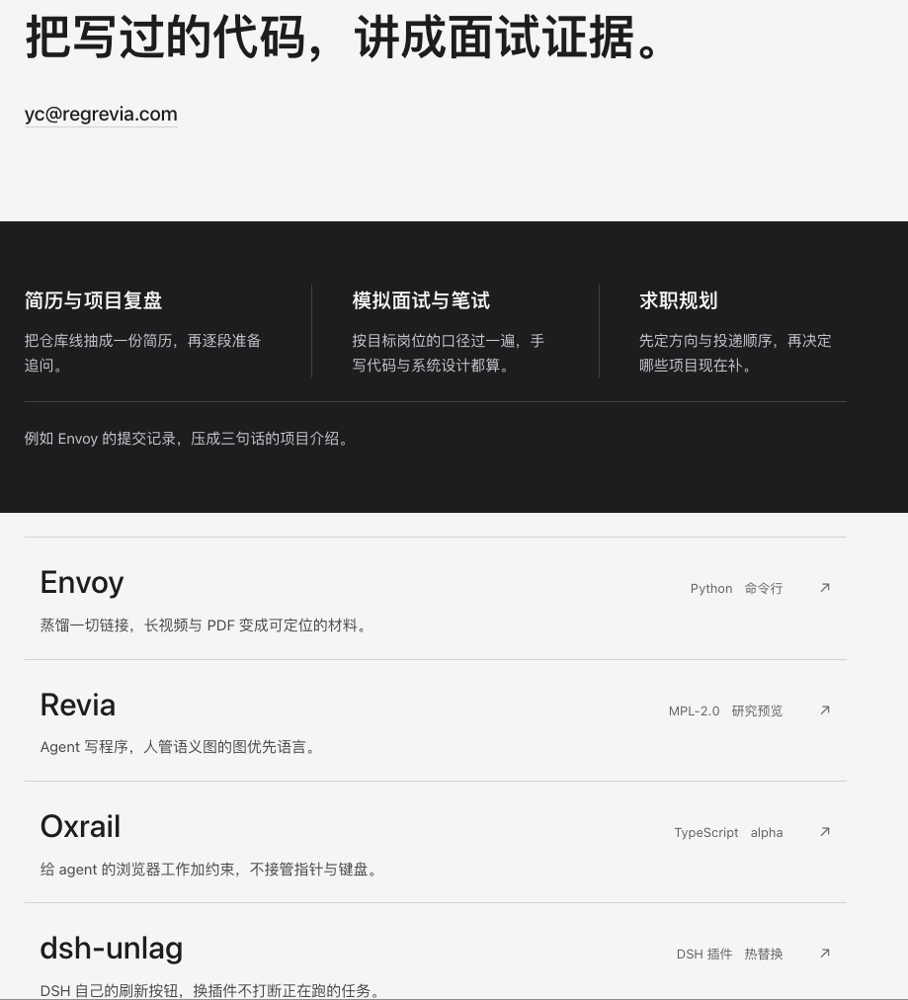

# AI Slop 反例与正向对照

本案例供维护者开发和评估 UI Guard 时查阅。原图、改写和文末练习共同记录这次判断的依据。

| 常见反例 | 审阅时看什么 | 正向样例 |
| --- | --- | --- |
| 空泛营销，如「全新体验，轻松实现无缝协作」 | 读者能否说出当前能做的事 | 「邀请成员」放在成员列表上方。 |
| 装饰抢主任务，如给每条记录加胶囊、重复标题和分隔线 | 读者能否一眼找到当前对象和下一步 | 用一条对齐的记录列表呈现对象和状态，突出需要处理的一项。 |
| 泛化的错误解释，如「出了点问题，请稍后再试」 | 读者是否知道哪个操作失败、可以怎样恢复 | 保存失败且允许重试时，显示「草稿保存失败」，在旁边提供「重试」。 |
| 金句压缩腔，如「把仓库线抽成一份简历」 | 实际对象是否清楚，多句连读是否反复套用同一种口号 | 「根据代码提交记录整理简历里的项目经历。」 |
| 页面任务跳转，如服务区结束后直接列出四个工具 | 下一段的用途是否清楚，读者是否能判断它和当前任务的关系 | 把 Envoy 练习放到「简历与项目复盘」服务旁，工具列表从「开源项目」标题开始。 |

## 反例｜技术求职辅导页



截图里的留白、黑白配色和短句都显得克制。首屏标题却要求读者先理解「面试证据」，再从下方三栏弄清楚有哪些服务。三栏标题已经能区分服务，描述又连用抽象动词、省略和两段式节奏。下方只有 Envoy 的提交记录被用作示例，项目清单随即以同等的视觉层级列出 Envoy、Revia、Oxrail 和 dsh-unlag。读者需要自行判断这些项目是否都是辅导材料。截图提供了可见文案与区块位置，可用来审阅首读顺序。

### 逐项改写

| 位置 | 截图原文 | 读者需要猜什么 | 正向改写 |
| --- | --- | --- | --- |
| 首屏标题 | 把写过的代码，讲成面试证据。 | 「面试证据」指哪项服务。 | **技术求职辅导**<br>整理简历里的项目经历，练习技术面试。 |
| 简历与项目复盘 | 把仓库线抽成一份简历，再逐段准备追问。 | 「仓库线」指哪份材料。「抽成一份简历」要交付什么。 | 根据代码提交记录整理简历里的项目经历，准备面试官可能问到的问题。 |
| 模拟面试与笔试 | 按目标岗位的口径过一遍，手写代码与系统设计都算。 | 「口径」指什么。「过一遍」具体练哪些内容。 | 按目标岗位的要求练习手写代码和系统设计。 |
| 求职规划 | 先定方向与投递顺序，再决定哪些项目现在补。 | 「补」指补做项目、补功能，还是补写简历。 | 确定求职方向和投递顺序，再讨论哪些项目需要完善。 |
| 服务示例 | 例如 Envoy 的提交记录，压成三句话的项目介绍。 | Envoy 在这里是什么，示例属于哪项服务。 | 用开源工具 Envoy 的提交记录做练习，试着用三句话介绍这个项目。 |
| Envoy | 蒸馏一切链接，长视频与 PDF 变成可定位的材料。 | 「蒸馏」做了什么，「一切」覆盖哪些链接。 | 在长视频和 PDF 里定位所需内容。 |
| Revia | Agent 写程序，人管语义图的图优先语言。 | 这是编程语言还是工具，两类参与者各做什么。 | 一种以图为主的编程语言。Agent 编写程序，人负责管理语义图。 |

### 区块顺序

这版以找技术求职辅导的访客为主要读者。首屏写明服务范围，把已有的联系入口放在服务说明旁。三项服务可以并排，但按各自的信息量决定行数。Envoy 三句话练习放到「简历与项目复盘」旁。保留项目清单时，用「开源项目」作为标题，让浏览工具成为清楚的次要入口。只有掌握其余项目确实用于辅导的材料后，才把它们写成服务案例。

## 维护者复测用提示词

```text
根据给定的页面目标、读者和现有内容，审阅并改写首屏、服务卡片和相邻区块。

1. 先按页面顺序读一遍，标出读者会在哪一句猜对象、动作、条件或结果，以及在哪个区块交界需要猜自己接下来在看什么。
2. 用读者熟悉的词写清楚具体内容。保留会改变理解或选择的细节。各卡片按内容自然成句，允许长短不同。沿用意思明确的短标签和受众熟悉的术语。
3. 把例子放到它对应的任务旁。用分区或具体标题表达段落关系。缺少证据的服务承诺、产品能力和项目关系留在审阅意见里，等确认后再写入页面。
4. 连读改写后的标题、卡片和下一段。确认第一次到访的读者能说出页面提供什么、各服务分别做什么、下一步可以做什么。

交付发生变化的原句与改写，以及需要调整的区块位置。说明每处改写解决了哪个具体误读。
```
